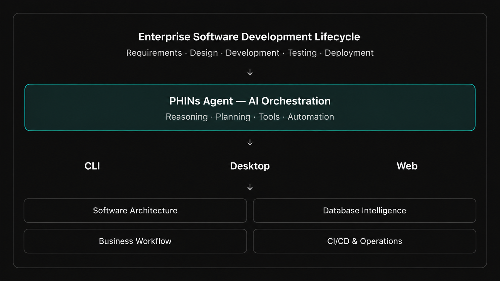

# PHINs Agent



> **From Ideas to Impact**

**PHINs Agent** is a terminal-native AI coding agent that investigates repositories, plans changes, executes approved tools, edits code, and tests the results. Its CLI and TUI share an engine with resumable sessions and inspectable actions.

**Nebius × NVIDIA Global AI Hackathon 2026** · **Coding and Agentic Engineering**

**[Watch the demo](https://www.youtube.com/watch?v=zNPvf9Mw8LQ)** · **[Try PHINs Agent — Quick Start](docs/QUICKSTART.md)** · **[Download v0.1.2](https://github.com/phins-group/phins-agent-cli/releases/tag/v0.1.2)** · **[Review test evidence](docs/BENCHMARK.md)**

## Try it in your terminal

Download a standalone build for your platform. **No Docker, local GPU, or Bun/pnpm installation is needed to run the binary.**

The [one-command installation](docs/QUICKSTART.md#1-install-and-launch) detects your OS/CPU, verifies checksums and then opens the TUI. macOS/Linux use `install.sh`; Windows has a native PowerShell command. Direct downloads are also available below.

| Platform | Download |
| --- | --- |
| macOS — Apple Silicon (M1/M2/M3/M4) | [ARM64 build](https://github.com/phins-group/phins-agent-cli/releases/download/v0.1.2/phins-0.1.2-local-darwin-arm64.tar.gz) |
| macOS — Intel | [x64 build](https://github.com/phins-group/phins-agent-cli/releases/download/v0.1.2/phins-0.1.2-local-darwin-x64.tar.gz) |
| Linux | [x64](https://github.com/phins-group/phins-agent-cli/releases/download/v0.1.2/phins-0.1.2-local-linux-x64.tar.gz) · [ARM64](https://github.com/phins-group/phins-agent-cli/releases/download/v0.1.2/phins-0.1.2-local-linux-arm64.tar.gz) |
| Windows | [x64 ZIP](https://github.com/phins-group/phins-agent-cli/releases/download/v0.1.2/phins-0.1.2-local-windows-x64.zip) |

**Requirements:** a terminal, internet access, and a [Nebius Token Factory](https://tokenfactory.nebius.com/) API key with access to the NVIDIA model and available inference credits. The reproducible coding demo additionally needs **Node.js 22+ and Git**. Supported OS versions and limitations are documented in the [Quick Start](docs/QUICKSTART.md).

Automatic installation on macOS/Linux also needs `curl`, `tar`, and a SHA-256
utility. The [Linux instructions](docs/QUICKSTART.md#linux--x64-or-arm64) explain
how to install `curl` if it is missing.

**For judges:** Open **[the 5-minute Quick Start](docs/QUICKSTART.md)**, choose your OS, download and launch the build, enter `/setup`, and select Nebius Token Factory and NVIDIA Nemotron 3 Super. Then follow the included coding demo. Setup takes approximately five minutes with prerequisites ready; the agent task itself may take longer and consume credits.

From the extracted build folder, launch PHINs Agent against a project you trust:

```sh
./phins "/path/to/your/reviewed/project"  # macOS / Linux
```

```powershell
.\phins.exe "C:\path\to\your\reviewed\project" # Windows PowerShell
```

Run `./phins` (or `.\phins.exe`) without a path to open normally. For download, extract, and demo commands, use the [platform-specific Quick Start](docs/QUICKSTART.md).

## Working demo: fix a real bug, verify the tests

The test build includes a reproducible coding task derived from an attributed historical [`vercel/ms` bug](https://github.com/vercel/ms/pull/111). A pinned input and **27 PHINs regression checks** are included in the demo archive; these are *not* the upstream full test suite.

1. **Reproduce:** Prepare the project and run its tests. The expected baseline is **22 passing, 5 failing**.
2. **Investigate and fix:** Ask PHINs Agent to inspect the repository, find the root cause, update the source, and execute permitted tests using an NVIDIA model on Nebius.
3. **Verify independently:** Re-run the tests outside the agent. The success condition is **27 passing, 0 failing**, with a reviewable patch. Actual model outcomes may vary.

Use the exact commands in **[Quick Start → Try the coding demo](docs/QUICKSTART.md)**. Technical review details and observed run evidence are in the [Judging Guide](docs/JUDGING_GUIDE.md) and [Benchmark](docs/BENCHMARK.md). The presence of passing scripted tests alone does not establish model success.

## NVIDIA + Nebius integration

For the hackathon workflow, PHINs Agent uses:

| Component | Role |
| --- | --- |
| **NVIDIA Nemotron 3 Super** | Reasoning and tool-use model; model ID: `nvidia/nemotron-3-super-120b-a12b` |
| **Nebius Token Factory** | Hosted inference API: `https://api.tokenfactory.nebius.com/v1` |
| **PHINs Agent** | Local agent runtime that prepares context, requests model decisions, executes permitted repository tools, and checks results |

The agent **makes runtime inference requests to Nebius Token Factory**. The model does not run locally, and the application does not require a local GPU. Local code inspection, editing and testing remain in the developer's environment. Nebius is an optional provider for general usage but is selected for this hackathon demo.

This integration enables access to a hosted NVIDIA model while retaining a local terminal-first coding workflow. It does **not** mean NVIDIA or Nebius endorses the product. No model weights are bundled.

## What makes PHINs Agent useful

- **Repository-aware workflow:** Select context and inspect code before acting.
- **Actionable agent:** Plan, read/search/edit files, and request tool execution subject to permissions.
- **Test-driven correction:** Use failing test results for bounded follow-up changes.
- **Reviewable output:** Inspect tool results, patches, sessions, usage, and estimated costs.
- **CLI + TUI:** Work in a developer's terminal rather than switching to a hosted web interface.
- **Isolated reviewed demo (macOS):** Constrain writable files and run independent verification on a read-only snapshot.

```text
CLI / TUI → agent engine → selected context → NVIDIA Nemotron
     ↑                                            ↓
verification ← tests ← approved edits/tools ← Nebius API
```

`packages/engine` manages agent workflows, providers, storage, and authenticated local transport. `packages/terminal` provides the CLI and Solid/OpenTUI interface. Primary technologies include TypeScript, Bun, Effect, and SQLite. See [Architecture](docs/ARCHITECTURE.md).

## Our Vision

We envision an AI-assisted engineering ecosystem that helps teams turn business
requirements into system designs, database schemas, working applications,
verified deployments, and continuously improving business processes.

The hackathon edition focuses on repository-aware coding and verification in a
local CLI/TUI. The diagram below illustrates our longer-term vision across CLI,
desktop, and web experiences, extending agent assistance to architecture, data
modeling, business workflows, and operations.



## Run from source (developers)

Source workflow qualified on **macOS ARM64**. Install Node.js 22+, Bun 1.3.12+, pnpm 10.26.0 and Git, then run:

```sh
pnpm install --frozen-lockfile --ignore-scripts
pnpm cli --help
pnpm cli setup
pnpm tui /absolute/path/to/your/reviewed/project
```

For one request:

```sh
pnpm cli ask "Inspect this repository and explain its test command" --project /absolute/path/to/project
```

The release CLI also supports `phins uninstall`; `--all` additionally removes the default profile after confirmation. See [Uninstall](docs/QUICKSTART.md#uninstall).

Inside TUI: `/models`, `/new`, `/sessions`, `/compact`, `/setup`, `/help`, `/exit`. Credentials are stored locally, **not in an encrypted OS keychain**. Source runs isolate state beneath `.local/home` (overridable using `PHINS_LOCAL_HOME`). Keep credentials outside the project under review.

To reproduce the historical source demo on the qualified environment:

```sh
pnpm demo:prepare
pnpm demo:test       # Expected to fail before the fix
pnpm demo:setup
pnpm demo:tui
```

Paste the request from `.local/demo-ms-pr111/task.txt` into the demo TUI. After the run, use `pnpm demo:test` again and inspect changes and the independent verification receipt. See [Judging Guide](docs/JUDGING_GUIDE.md).

## Build, tests, and evidence

```sh
pnpm source:check
pnpm check
pnpm test
pnpm build
pnpm test:coding
```

The local build generates `dist/phins` or `dist/phins.exe`. `pnpm build:all` targets macOS ARM64/x64, Linux ARM64/x64 and Windows x64. macOS binaries are ad-hoc signed, not notarized. Scripted-provider tests are distinct from real model evaluations; see [Benchmark](docs/BENCHMARK.md).

**Known limits:** The reviewed hardened profile and snapshot check are qualified on macOS; Linux/Windows hardened execution, broad task success, and CPU/memory quotas have not been qualified. Independent final verification requires tests that run without network access or filesystem writes. API inference consumes Nebius credits; application spending indicators are not provider billing caps. See [Local Operation](docs/LOCAL_OPERATION.md).

## Hackathon submission notes

- **Track:** Coding and Agentic Engineering.
- **Video:** [Public YouTube demo](https://www.youtube.com/watch?v=zNPvf9Mw8LQ).
- **Working test build:** [Release v0.1.2](https://github.com/phins-group/phins-agent-cli/releases/tag/v0.1.2), with [installation and verification instructions](docs/QUICKSTART.md).
- **Evidence:** [Benchmark](docs/BENCHMARK.md) and [Judging Guide](docs/JUDGING_GUIDE.md).
- **Nebius/NVIDIA feedback:** To be submitted in the Devpost submission form based on actual development and inference experience.
- **Project evolution during the submission period:** If PHINs Agent predates August 26, 2026, the Devpost entry must identify and substantiate substantial changes made since that date. Consult commits and release history; do not infer dates or contributions from this README.
- **Judge access:** The build is publicly linked, but using the model currently requires an API key and available inference credits. **Free, unrestricted judging access is not yet established by this README.** Arrange access for judges without publishing credentials, and confirm it meets the [official rules](https://nebiusglobalaihackathon.devpost.com/rules).

## License and third-party notices

PHINs contributions: Copyright 2026 Duy Huynh, **[Apache-2.0](LICENSE)**. Inherited MIT-licensed code retains its terms: [NOTICE](NOTICE), [Provenance](PROVENANCE.md), [Third-party licenses](THIRD_PARTY.md). `Apache-2.0 AND MIT` does not mean users may choose either license for every file. Respect applicable attribution and trademark rights.

[Devpost submission draft](docs/SUBMISSION.md) · [Demo script](docs/DEMO_SCRIPT.md) · [Official hackathon rules](https://nebiusglobalaihackathon.devpost.com/rules)
