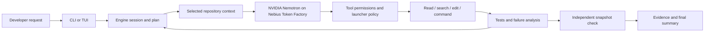

# Architecture

CLI and TUI use the same local session lifecycle and agent loop. This source
builds without a proprietary backend.

| Component | Responsibility |
| --- | --- |
| `packages/engine` | Tools, sessions, planning, correction limits, permissions, provider transport, SQLite and verification |
| `packages/terminal` | CLI dispatch, local lifecycle, Solid/OpenTUI, provider setup and evidence display |
| Local transport | Authenticated loopback engine communication; no hosted API required |
| `configs` / `examples` | Key-free provider example, source inventory and attributed demo inputs |
| `scripts` | Isolated launch, build, tests, source checks and disposable demo |

Repository text/tool output cannot override execution policy. The reviewed demo
requires inspection, a plan and baseline before edits; limits correction rounds;
allows one test command and one writable source file. After edits, a read-only
snapshot check runs through the same permission boundary. Its receipt applies
to that snapshot, not to later modifications.

Repository tools select context and bound results. Provider usage feeds visible
token/context and estimated cost. Persistent sessions resume work; estimates do
not replace billing.

Nebius Token Factory uses the existing OpenAI-compatible route. The demo selects
`nvidia/nemotron-3-super-120b-a12b`; it reasons and chooses tools in the core loop.
Keys come from masked setup or private environment configuration. Transport
handles timeouts, bounded retries and rate limits. Actual availability and success
still need current live evidence.

Local state isolation alone is not a sandbox. The demo also enables the native
macOS process policy, restricts writes, denies test-process network and strips
sensitive child environment variables. Engine model HTTP requests remain possible.
Cross-platform containment, CPU/memory/process-count quotas and broad task success
are not established by local fixture tests. Review ordinary project configuration
before permitting its plugins, MCP or commands.
